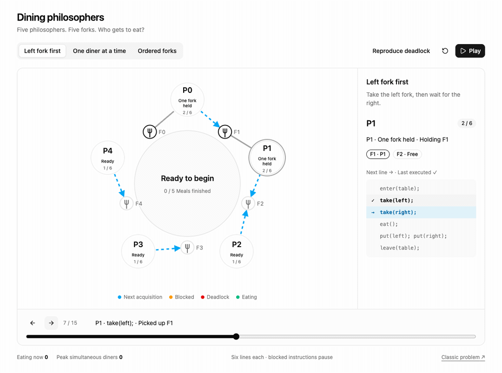
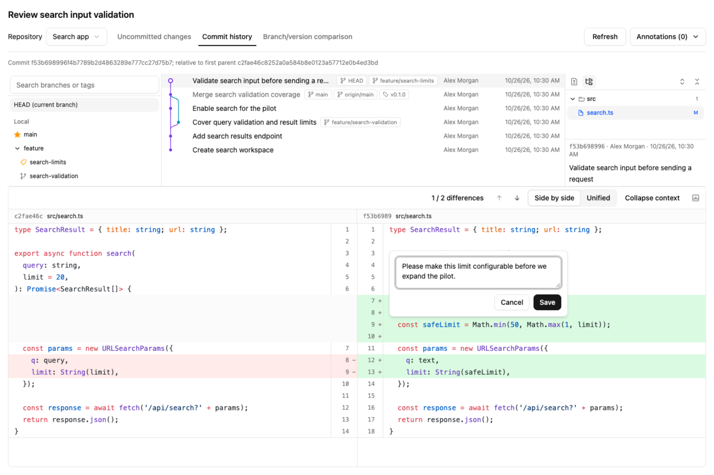

# Paneon

[](https://nodejs.org/en/download)
[](LICENSE)

[English](README.md) | **简体中文**

**让 AI 的回答变成可以动手探索的页面。**

Paneon 让 Agent 在你的电脑上生成交互页面。你可以在页面里理解原理、探索数据、评审代码，再把选择和批注带回对话。

> 用 Paneon 解释哲学家就餐问题



看每个人依次拿起叉子，再看为什么所有人都卡住了。

## 为什么不直接写个网页？

Agent 也能临时写一个 HTML 页面。用 Paneon 的区别在于：

- **反馈能回到 Agent。** 你的回答、填写的内容、针对某一行的批注，都会直接回到对话里。
- **页面写起来更省事。** Agent 直接使用现成的页面和组件，不用从头手写界面，所以出页面更快、更省 token，风格也统一。
- **页面能用你本地的东西。** 页面可以读取本地仓库、文件和命令行工具，只在你的电脑上提供访问。

## 开始使用

当前为开发预览版，需要 **Node.js 24**。

```sh
git clone https://github.com/qoggy/paneon.git
cd paneon
npm ci
npm run build
npm install -g .
```

然后在你使用 Agent 的项目中运行：

```sh
paneon init
```

选择你的 Agent（如 Claude Code、Codex），安装 skill。之后让它使用 Paneon，打开它给你的链接即可。

## 一起评审代码

> 用 Paneon 评审这次提交

浏览改动，把意见直接附在对应的代码上。



## 更多用法

- “用 Paneon 解释这个缓存的工作原理。”
- “用 Paneon 分析这些性能测试结果。”
- “用 Paneon 对比这几种架构。”

选择题、表单、表格、文档评审、Git 评审和 GitHub PR 都有现成页面。其他需求由 Agent 编写自定义页面。

## 反馈

问题和建议请提交到 [Issues](https://github.com/qoggy/paneon/issues)，版本变更见 [CHANGELOG](CHANGELOG.md)。

## 许可证

[MIT](LICENSE)
