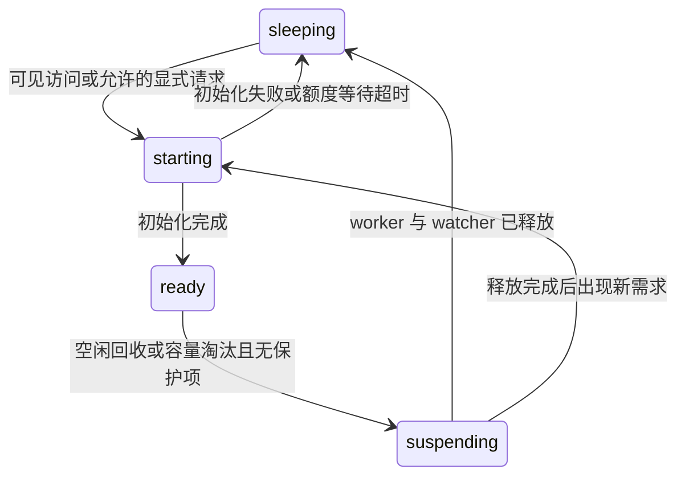

# Panel resource lifecycle

## 需要你处理的事项

本稿是待评审设计，默认值与接口均未实现。没有把下面的推荐当作已获批准的产品结论。

### 需用户提供的信息

无。现阶段依据本地源码足以设计；性能阈值须用验收数据验证，不能由当前 RSS 样本推算容量。

### 需用户拍板的决策

- **B1**：是否采用「默认自动休眠，隐藏或断开后 5 分钟可回收」？推荐采用。可见页通常保持就绪；资源紧张时也可回收没有进行中调用的普通可见页执行环境，但保留 iframe。另一选项是只回收已经关掉标签页的实例，打扰更少，但遗忘的后台标签页仍长期占资源。
- **B2**：是否接受「普通面板服务端内存可以重建，需要持续工作者显式声明常驻」？推荐接受；普通用法不增加参数，常驻模式由作者在定义中声明。另一选项是全部默认常驻，只有作者声明可休眠才回收，兼顾任意模块内存语义，但解决不了大量现成面板遗忘关闭的问题。
- **B3**：是否采用初始配额「最多 8 个驻留执行环境、最多 2 个并行构建」？推荐作为可配置的初始值，不宣称是性能上限。配额包括常驻面板；没有可安全回收的槽位时返回明确的资源繁忙，不终止正在进行的工作。另一选项是不设硬配额，交互限制更少，但无法限制后端进程数量。

### 需用户确认的风险

无待确认风险。原 C1（原始快照落盘）已撤销：该前提源于当前实现对后台 Map 的依赖，不是休眠或批注所必需；本编号不复用。已提交的批注事件仍会按现有机制写入 SQLite。

### 已确认结论

- **B4**：产品尚未发布第一个版本，不考虑历史接口兼容，不保留旧名称别名或兼容映射。
- **B5**：本轮只设计，不开发。
- **B6**：批注绑定用户当时在页面上看到的内容；后续工作文件、分支、commit 或 PR 更新不得替换批注的原文、版本和位置。
- **B7**：组件/页面持有展示数据和批注来源；Diff 的核心输入是两个字符串，Git 读取组件可封装 serverAction 和点击回调；批注提交携带完整上下文，不依赖旧后台进程的业务 Map，不以强制快照落盘换取可休眠性。
- **B8**：未提交草稿只在浏览器内存中，关闭或刷新页面后可能丢失；本设计不增加草稿持久化。

## Context

### 仓库和基线

唯一受影响仓库为 `paneon`，路径 `/Users/yuguo/IdeaProjects/paneon`，分支 `0.0.x`，本次修订基线 `a32404d`（初稿基线 `cf5a4af`）。当前另有未提交的 shutdown 改动及 runtime logging 设计；它们不是本设计的实施产物，不能覆盖、重置或夹带提交。实施前重新核对实际 HEAD 和工作区。

### 已确认的现状

- `src/runtime/lifecycle.ts:25,245`：每个成功 run 的实例均创建长期 Execution 子进程，不取决于是否有人打开页面。
- `src/runtime/worker.ts:42`：每个执行进程初始化 Vite ServerModuleRunner；`lifecycle.ts:252` 在 watch 时另开源码监听环境。
- `src/web/panel-host.tsx:100`：卸载页面只释放连接，不调用 closePanel；没有 idle 回收。
- `src/runtime/lifecycle.ts:180`：服务启动逐个 load 所有未关闭实例，load 会重新编译并启动执行环境。
- `src/runtime/store.ts:50,108`：单实例 get 先读全表并解析全部 params，再 find。
- `skills/paneon/assets/panels/git-review/panel.tsx:131,275`：浏览器也保存 GitSnapshot（来源、完整原文、DiffModel），可显示和定位既有批注。
- `skills/paneon/assets/panels/git-review/git.ts:275-303,726-774`、`skills/paneon/assets/examples/github-pr/github.ts:168-190,602-631`：后台另有快照及会话 Map；当前校验只接收 sourceId 并查后台 Map，Git 后续读取也依赖 listing/history 缓存。结束进程会破坏这些当前实现路径，但不代表浏览器原文消失，也不能据此推导必须落盘。
- 静态构建文件和事件已落盘，但文件服务依赖 live map。当前不是「只留一条数据库记录」的资源模型。

2026-10-23 的一次本机只读采样：10 个 worker 的 RSS 合计约 161 MiB，大多没有 CPU 活动。该采样不含主进程、浏览器和换出内存，不是压测或每实例定额。

## Goals / Non-Goals

**Goals:**

- 面板和事件可以保留，未使用的后台执行资源不必一直保留。
- 所有新实例默认可按需运行，不要求 Agent 每次填生命周期参数；提供明确的常驻例外。
- 重启时间不再包含所有未关闭实例的构建与 worker 启动。
- 多标签页、进行中调用、浏览器拥有的批注来源、凭据交互和源码更新均有明确边界。
- 限制驻留 worker 和构建并发；历史数量不再使单实例查询扫描所有参数。

**Non-Goals:**

- 不自动删除面板、事件、消费者游标、作者数据或未提交草稿。
- 不把休眠变成永久关闭；不因提交过一次就自动关闭。
- 不把任意业务后台任务迁入 Paneon 调度器，也不自动恢复被中断的外部命令。
- 不新增 Git/PR 原始快照落盘、批注数据库或通用业务数据目录；不序列化任意 JS 堆、Map、数据库连接或 React 状态；不承诺浏览器关闭后恢复未提交草稿。
- 不靠 OS 进程暂停保留全部内存；真正释放资源必须终止可重建执行环境。
- 不在本任务中替换整个 Vite 执行模型，也不把配置默认值当作已测容量。

## Decisions

### 实例身份和执行环境分离

推荐状态模型：

```ts
type PanelStatus = 'open' | 'closed' | 'unavailable';
type ExecutionState = 'sleeping' | 'starting' | 'ready' | 'suspending';
type ExecutionMode = 'auto' | 'persistent';
```

`open` 表示可访问的实例，可能没有 worker；`closed` 表示用户明确关闭，不能被普通访问唤醒；`unavailable` 表示定义/构建不再可用。执行状态由当前进程派生，不将 ready 跨服务重启持久化。恢复执行失败用独立 executionDiagnostic 报告；有效静态页面仍保留，不能假装已经执行了请求。



显式 close 从任何执行状态进入实例 closed，继续采用当前关闭操作的终止语义；自动休眠绝不借用 closePanel。按实例串行状态转换，每个实例最多一个 ensureReady promise；分配额度时计入 starting 槽位，不能只统计已 ready 的进程。

### 默认策略与配置

推荐定义写法（可省略，省略即 auto）：

```ts
definePanel({
  id: 'continuous-monitor',
  requires: { paneon: '^0.0.0' },
  execution: { mode: 'persistent' },
  input,
  render,
});
```

persistent 表示模块内存和后台计时器在服务存活期不参与自动回收，不代表任务调度、崩溃恢复或修改源码后任务交接。服务重启只恢复这些显式声明的实例，仍受执行配额约束；不恢复所有 auto 实例。

全局配置仍在唯一的 `~/.paneon/config.json`：

```json
{
  "ui": { "theme": "light", "language": "en" },
  "resources": {
    "idleTimeoutSeconds": 300,
    "maxResidentExecutions": 8,
    "maxConcurrentBuilds": 2
  }
}
```

新增 `paneon config set resources.idleTimeoutSeconds 300`、`resources.maxResidentExecutions 8`、`resources.maxConcurrentBuilds 2`。取值分别为 30–86400、1–64、1–8 的整数。这是初始配置范围，不是安全/性能保证。UI 设置只保留主题/语言，不塞入资源参数表单。

Runtime 统一拥有配置对象并串行原子写入，Preferences 不再长期保留另一份可覆盖新字段的旧配置快照。更新 ui 必须保留 resources，反之亦然。降低额度不杀 busy/persistent worker，进入超额但不再新增的状态，待释放后收敛。构建等待队列最多 32 项，等待超过 30 秒返回 RESOURCE_BUSY；运行中的构建仍遵守既有终止/诊断规则。8 个限额只针对长期 Execution；最多 2 个构建会额外产生短时 compiler/metadata 子进程，作者自行启动的外部进程也不被计作已受控驻留进程。

### 可见性租约和空闲判定

宿主产生随机 clientId，通过独立 HTTP presence 接口报告可见/隐藏。保持现有 WebSocket 只读状态通知约定，不往其输入通道塞控制命令。

- document 变 visible 时立即报告并请求唤醒；每 30 秒续约，可见租约 90 秒到期。
- document 变 hidden 时立即报告一次；关闭、崩溃和网络断开靠租约到期，不依赖 beforeunload 成功送达。
- 多标签页按 clientId 聚合；任一有效可见租约都算有人使用。其他标签页隐藏不覆盖可见标签页。
- auto 实例无有效可见租约、无进行中工作后开始 300 秒宽限；请求/工作完成重新计算安全空闲起点。仅 list/inspect、读取旧事件、ack、WS ping 或隐藏页心跳不延长活跃期。
- 状态重连只读取状态与刷新租约，不重放 mutation 或 emit。clientId 是去重标识，不是鉴权凭据。
- 租约丢失但浏览器仍在时，后台可以休眠；宿主不能因 executionState 变化卸载 iframe。连接恢复后仍可用原 React 草稿继续交互。

宿主把有效 visibility/presenceId 传入桥接请求；auto 的隐藏页新调用返回 `PANEL_INACTIVE`，不能反复唤醒。宿主经带 channelId 的 BridgeVisibility 消息同步状态，SDK 不信任任意窗口发来的 visibility 消息。SDK `useQuery` 在隐藏时停止定时 refetch，恢复可见后只发起一次新的 query；此前已接收的调用仍可完成。自定义计时器收到该错误不得由框架自动重试；需要后台调用者声明 persistent。显式 CLI 控制操作沿用 control token，可按需启动；无需假装成可见浏览器。

### 回收保护和额度

ResourceManager 管理 worker 槽位、构建槽位、可见租约与调用计数。所有 invoke、事件校验/追加和 reload/build 的受保护阶段必须先取实例操作租约，finally 释放；保护不能只覆盖 HTTP 请求存活期，因为浏览器断开不代表 serverAction 停止。

自动回收不能越过：

- 正在执行的 query、mutation、事件校验或事件事务；
- 正在初始化/发布的 build 或 wake；
- persistent 模式；
- 正在进行的临时凭据输入。凭据提示由宿主报告带租约的 credentialPromptOpen；不保存秘密值。该保护随提示取消或租约失效结束，不额外延长可见租约，也不通过服务端自行续期。

达到 worker 上限时优先回收不可见 auto，其次最久未调用的无保护 auto（即使可见）。persistent 和忙碌 worker 不可淘汰。可见页面被淘汰时保留 DOM；下次调用在 dispatch 前等待 ensureReady，不重载页面。

没有候选时最多容纳 32 个等待唤醒的不同实例，每项最长等待 10 秒；同实例请求合并初始化但分别执行各自调用。等待失败返回 `RESOURCE_BUSY`，框架不重试。尚未获得 worker 的 mutation 没有执行；一旦进入 handler 后断链，继续使用当前「结果未知，不自动重试」语义。

自动回收先原子进入 suspending 并停止接纳新 dispatch，再关源码 watcher、撤销该实例临时凭据、停止 idle worker，最后释放额度。此时不该有业务调用；新请求等释放完成再申请一个新环境，不能把旧停止信号发给新 worker。单一全局清扫定时器而非每实例一个 timer；过期租约及时移除。错误结束时也释放槽位和计数。

### 静态页面、watch 和启动

run 仍校验输入并完成初始构建，打印 URL；auto 不因此创建长期执行进程。打开 URL 可先从不可变产物显示页面，再由可见租约按需准备后端。页面纯阅读不依赖 ready；serverAction 和 emit 必须经 ensureReady，事件仍使用原 Zod schema/transform，不能用 JSON Schema 替代执行校验。

持久化 manifest 与产物位置使 `inspect` 和文件服务无需 live map。普通重启仅打开数据库、读取配置和整理状态，不逐个 recompile。persistent 实例有界排队恢复；一项失败不阻塞首页或其他实例，超额项目显示待启动原因而不创建额外 worker。

watch 只在有驻留执行环境时建立，休眠时关闭；唤醒前检查已捕获依赖的当前内容摘要。auto 在休眠期不是连续源码监听器，这是有意改变的契约。实际源码未变时复用原 revision 和 iframe；实际改变时按既有源码更新规则编译并通知 revision 变化，不建立旧 worker 交接机制，也不承诺真实源码更新不丢草稿。`--no-watch` 的唤醒使用既有固定产物，只有显式 reload 重新读源文件；不能把休眠偷偷变成 reload。

worker 内部 Vite 只读取不可变已编译 server bundle，禁用多余的工作目录文件监听；驻留实例的 watch 仍复用现有 Vite watcher 实现，不编写另一套 HMR 引擎。

### 组件数据归属与后台职责

组件组合遵循以下输入与职责边界。下表表达 API 设计约束，不在本 change 中顺便发布全部 Git 组件；具体导出名称不在这里虚构为已实现接口。

| 组件或能力 | 关键 props / 回调 | 后台职责 | 状态归属 |
| --- | --- | --- | --- |
| 通用 Diff | oldText、newText；可选文件路径/版本、批注来源引用与交互回调 | 展示、差异计算和批注不要求调用 Git | 浏览器保留原文、模型和目标引用；不要求业务 session |
| 分支列表 | 仓库路径、当前选中项、选择回调 | 组件/配套读取层通过 serverAction 执行 Git 读命令 | 已返回列表与选择在浏览器；后台缓存仅为可丢弃加速 |
| Commit 图 | 仓库路径、分支/固定 tip、筛选/分页参数、选择回调 | 根据显式输入读取拓扑和提交信息 | 浏览器保留已展示结果；分页游标含固定 tip/排序位置，不能仅是进程内 Map 的 key |
| Commit 改动列表 | 仓库路径、固定 commit/parent 或比较范围、文件点击回调 | 按显式版本读取改动文件；工作区点击时读取当次文件内容并返回新内容标识 | 浏览器保留返回的来源和文件内容；不把后来读到的数据冒充旧展示 |
| 批注能力 | 页面/组件提供的语义 ref、原文和坐标；提交回调 | 校验提交结构/内部一致性并保存显式事件 | 草稿和当次来源在浏览器；成功提交后事件在 SQLite |

Diff 不强制要求 repositoryPath、commit 或后台 sourceId；它也可以比较用户提供的两个字符串。Git/PR 包装层负责将仓库、固定版本、文件路径等上下文组合到批注来源，通用批注 Provider 继续接受作者定义的 JSON ref，不增加 Git 专用框架协议。

后台仍执行 Git/gh 命令和原有访问限制，但不因要校验批注而成为展示数据的唯一所有者。后续读文件、翻页、切换分支的 serverAction 接收显式仓库/版本/路径/游标，允许在新 worker 中执行，不依赖旧 sessionId/listingId/historyId 对应的必需内存。可选缓存必须有界，miss 可重建。固定提交读其明确 OID；工作区/可变 PR 的重新读取属于新数据，返回新内容版本，不能覆盖已被批注引用的数据。

### 批注携带当时来源与原文

浏览器保存只读的当次展示版本；批注创建后始终引用该版本。已被草稿或已提交待更正结果引用的内容不能因视图切换、刷新查询或普通 LRU 淘汰而替换。未引用的旧浏览数据可有界淘汰；仅创建新视图数据，不自动改写旧批注。销毁浏览器页面后这些内存数据可以丢失。

显式提交时，页面从自己保留的数据生成完整批注事件。以下为新的 Git 场景结果契约示例；JSONC 注释用于说明，不进入实际 JSON。它扩展页面自有 sources 内容，通用 Feedback 的 annotations / comment 结构不变；不是当前已实现的事件格式，也不要求发送整个 GitSnapshot、DiffModel、文件列表或仓库。

```jsonc
{
  "annotations": [
    {
      "id": "a1",
      "targets": [
        {
          "ref": {
            "kind": "lines",
            "sourceId": "display-1", // 本事件 sources 中的键，不查旧后台 Map
            "side": "new",
            "startLine": 1,
            "endLine": 1
          },
          "text": { "start": 16, "end": 20, "quote": "3000" }
        }
      ],
      "comment": "这里为什么改成 3000？"
    }
  ],
  "sources": {
    "display-1": {
      "repositoryId": "repo-1", // 对应当前面板输入中的仓库配置
      "view": { "type": "changes", "area": "unstaged" },
      "old": { "path": "config.ts", "contentHash": "sha256:67daf7f4caf7d23d1f4c38d2e5f517daac4cc3f757f0c566708bc465b1d06398", "type": "text" },
      "new": { "path": "config.ts", "contentHash": "sha256:a0107fb0542c305be7880efe147ce00f0e49b2d30392ce2799dccfef2a2803c7", "type": "text" },
      "evidence": [
        {
          "kind": "lines",
          "side": "new",
          "startLine": 1,
          "endLine": 1,
          "text": "const timeout = 3000;\n" // 当时所选行范围的完整原文；不是从最新文件重读
        }
      ]
    }
  }
  // 可附整体 comment 与 replacesEventId；更正仍是一个完整结果。
}
```

示例偏移相对于 evidence 对应的所选行范围原文，使用 UTF-16 左闭右开区间；行号从 1 开始。sourceId 标识不可变展示版本，原文或来源改变必须生成不同标识。重复目标可共享 source 和去重后的 evidence。

| 批注目标 | 必须携带的证据 | 校验边界 |
| --- | --- | --- |
| 整文件 / 二进制文件 | 仓库/比较范围、当次路径、各侧存在性/类型和内容哈希；不凭空添加文本范围 | 校验来源结构、配置仓库归属和文件级语义，不要求附完整文件 |
| 行或选中文字 | 来源 + 侧别、绝对起止行号、该行范围完整原文 + 选中 quote/UTF-16 偏移 | 校验 evidence 行数、坐标、quote 与完整字素边界；不得用首个同名词匹配 |
| 差异块 | 来源 + old/new 范围、当时 patch 及构成该块的 old/new 原文片段 | 从提供片段校验 patch/行数/范围，不要求整文件模型或后台 hunk Map |
| PR 描述 / 检查 / 概览对象 | 仓库与 PR 标识、当时 base/head（适用时）、observedAt、对象语义 ID、当时展示的对象字段或原文及内容标识 | 校验目标在所附当次对象中可解释；不重新查询远端最新对象来替换 |

后台通过页面自有纯校验函数验证来源、所选证据与目标之间的一致性，运行时继续使用声明的完整 Zod schema 校验并一次追加事件。sources 中的 contentHash 是完整内容的版本标识；仅附选中片段时不能重新计算完整文件哈希，更不能声称由此独立证明内容来自某个 Git commit。这里记录用户针对当时页面内容的意见，不设计一个证明客户端可信的签名/取证系统；格式非法、来源缺失、范围冲突则拒绝并保留草稿。

每次事件仍受当前 65536 UTF-16 字符上限和完整请求 262144 UTF-8 字节上限约束。提交仅附目标需要的原文及必要上下文，去重相同来源，不附整个仓库或无关完整模型。超限明确失败、保留草稿，由用户缩小或拆分其评审范围后重新明确提交；框架不截断、不隐式分批、不改为临时快照落盘，也不在本设计中扩大限额。

批注保存到草稿只是浏览器内存变化；只有用户点击提交且收到成功回执后，才写入 events.payload_json。事件可能包含选中文本、patch 或 PR 私有内容，这是原有显式提交的数据，不是后台自动缓存全部文件。唤醒、连接恢复、读取新版本都不自动提交或重放 mutation。

其他自定义页面：可重建的后台缓存用 auto；确实依赖持续后台内存/连接的页面才声明 persistent。Git/PR 批注本身不构成必须常驻的理由。

### 持久化结构

SQLite 新结构的相关字段如下，其余输入/事件字段维持现有含义：

```sql
CREATE TABLE panels (
  id TEXT PRIMARY KEY,
  definition_id TEXT NOT NULL,
  entry_path TEXT NOT NULL,
  cwd TEXT NOT NULL,
  params_json TEXT NOT NULL,
  revision TEXT NOT NULL,
  artifact_key TEXT NOT NULL,
  execution_mode TEXT NOT NULL CHECK(execution_mode IN ('auto','persistent')),
  watch INTEGER NOT NULL,
  status TEXT NOT NULL CHECK(status IN ('open','closed','unavailable')),
  created_at TEXT NOT NULL,
  updated_at TEXT NOT NULL,
  requires_json TEXT NOT NULL,
  paneon_version TEXT NOT NULL,
  diagnostic_json TEXT
);
CREATE INDEX panels_status_created_id ON panels(status, created_at, id);
CREATE TABLE artifact_gc_candidates (
  artifact_key TEXT PRIMARY KEY,
  unreferenced_since TEXT NOT NULL
);
```

不存 lastVisibleAt/ready/pendingRequests，防止重启把旧客户端或工作误当存活。实例 `get(id)` 直接 `WHERE id=?`，list 继续 SQL 分页并不读 params；restore 只查询需要恢复的 persistent 记录。events、consumers 表保留，不因休眠删除、重发或改变游标。

内存结构有明确边界：

```ts
type ExecutionRecord = {
  state: 'starting' | 'ready' | 'suspending';
  pendingOperations: number;
  lastCompletedAt: number; // 单调时间
  generation: number;
  ensureReady?: Promise<void>;
};
type Presence = {
  clientId: string;
  instanceId: string;
  revision: string; // 宿主当前显示的产物，保护旧版本资源引用
  visible: boolean;
  credentialPromptOpen: boolean;
  expiresAt: number; // 单调时间；过期清除
};
```

无驻留和无租约实例不在 execution/presence map 中；资源状态通过缺省 sleeping 推导，不能为全部历史实例常驻大对象。

共享产物改为 `~/.paneon/artifacts/<packageVersion>/<sourceRevision>/`，包含现有 client/server 文件和 manifest，manifest 增加用于唤醒核对的依赖内容摘要：

```json
{
  "definitionId": "standard-git-review",
  "revision": "sha256:7a2f...",
  "execution": { "mode": "auto" },
  "dependencies": ["/work/skill/assets/panels/git-review/panel.tsx"],
  "dependencyHashes": { "/work/skill/assets/panels/git-review/panel.tsx": "sha256:81bc..." },
  "serverEntry": "server/server.js",
  "clientEntry": "frame.html"
}
```

示例省略其余既有 manifest 字段。artifactKey 同时包含 packageVersion 和 sourceRevision；不同输入实例可以共享代码，不共享 params、浏览器草稿或展示结果。已知 manifest 可核验内容键时按 key 合并；首次尚未知完整依赖时按入口真实路径、工具版本和编译选项合并构建，源码途中变化由现有 snapshot 一致性检查拒绝。发布使用临时目录原子替换，不让读者看到半份文件；内容键也覆盖 Paneon UI/SDK 构建摘要与编译选项，不能仅因版本号未变就复用过期库代码。

### 构建缓存与磁盘边界

不自动删除事件和作者数据。只自动清理「没有 open 实例引用、没有进行中构建/文件响应/可见旧 revision 租约引用，且连续 24 小时无引用」的构建产物。候选列表由 manifest/实例关系决定，首次无引用时间写入 artifact_gc_candidates；重新引用时删除该候选，重启不重置宽限。删除前再次核对引用并加互斥保护。closed 实例保留身份和事件，但不要求永久保留可执行构建文件。

内存 manifest LRU 上限 32 条且累计编码体积不超过 16 MiB；超大 manifest 直接读用，不加入缓存。不可把整个历史的 manifest 一次读入内存。SQLite 的文件缓存由既有 SQLite 管理，不增加全实例 JS 缓存。

本方案限制的是运行资源和无用构建缓存；面板历史及已提交事件仍随实际使用增长，明确不宣称磁盘总量有硬上限。没有未经授权的静默清空历史。清扫只处理 Paneon 自己的 artifact 根目录，不触碰源码、cwd、node_modules 或作者自建的数据目录；本 change 不新增审阅快照目录。

### HTTP、桥接和 CLI 清单

| Method / path 或命令 | 入参和行为 | 关键结果 |
| --- | --- | --- |
| `GET /api/panels` | SQL 分页，不启动 worker | status、executionState、executionMode、活跃引用数摘要 |
| `GET /api/panels/:id` | 返回持久化 manifest/输入，不唤醒 | open + sleeping 可以正常返回 URL |
| `GET /panels/:id/:revision/*` | 从不可变产物读取，不依赖 live | 原 HTML/JS/CSS |
| `POST /api/panels/:id/presence` | `{clientId,revision,visible,credentialPromptOpen}`，沿用 Host/Origin 校验 | `{executionState,leaseExpiresInSeconds:90}`；visible 可申请唤醒 |
| `POST /api/panels/:id/wake` | 显式唤醒；CLI control 或有效可见宿主 | single-flight 的 ready 状态或结构化错误 |
| `POST /api/panels/:id/actions/:actionId` | 桥接附 presenceId，先取得操作租约和 ensureReady，再复核 revision、执行一次 | 原 action 返回值；RESOURCE_BUSY / PANEL_INACTIVE 等 |
| `POST /api/panels/:id/events` | 同样先保护并唤醒，使用原 Zod 校验后追加 | 既有事件回执；不能自动重发 |
| `POST /api/panels/:id/reload` | 显式更新代码，使用构建配额 | 新 revision；auto 没有调用者时回到 sleeping |
| `POST /api/panels/:id/close` | 保留显式关闭语义 | closed；普通访问不能复活 |
| `GET /api/panels/:id/stream` | 仍只读，新增 executionState / executionDiagnostic 通知 | 一个状态监听器共享广播，不为历史实例创建 socket |
| `GET /api/resources` | 只读统计，不启动面板；不含 params、快照或秘密 | ready/starting/persistent/busy/build/queue 数与配额 |
| `paneon panel wake <id>` | 显式准备环境，不执行业务函数 | 新执行状态和 URL |
| `paneon config get/set` | 扩展 resources 键并复用原子存储 | 完整有效配置或校验错误 |

API 的既有 Origin/Host、CLI 控制令牌、负载限制不放宽。visible 和 credentialPromptOpen 是资源提示，不是权限证明。Presence 不改业务更新时间；WebSocket 不重放请求。临时唤醒错误不改实例可用性，关闭/源码失效单独报告。休眠状态通知同时让宿主把该实例已有的凭据展示标为 revoked；不能在后端撤销后仍向用户显示可用，秘密值不进入通知。

### 用户界面分镜

首页仍使用现有列表与 shadcn 默认风格，不增加每个面板的常驻控制条。示例：

```text
Paneon                              驻留 2 / 8 · 休眠 37
Git 审阅      [休眠]   [自动]        打开   唤醒   关闭
持续监控      [就绪]   [常驻]        打开          关闭
方案评审      [就绪]   [自动]        打开          关闭
```

1. 打开休眠页面：先显示原静态内容，宿主短暂显示「正在准备交互环境」；ready 后提示消失。准备失败只显示可重试的诊断，不清空 iframe 或表单。
2. 页面转后台：没有弹窗、倒计时或要求用户关闭。宽限到期后释放后台 worker；再次回到前台按需准备，不重新执行已经发出的 mutation。
3. 用户正输入批注：iframe 未卸载且源码 revision 未变时文字不丢；Git/PR 的当次原文和来源仍在浏览器，提交携带所需证据；新 worker 无需找回旧业务 Map。
4. 资源忙：当前页面保留；宿主说明「运行资源已满，请关闭常驻面板或稍后重试」，按钮只重新准备环境，不自动重试原业务提交。
5. 长任务/监控：显示常驻身份。任务仍由作者负责，Paneon 不以后台可见性去终止它。
6. 用户明确关闭：继续显示已关闭、历史保留状态，不提供暗中唤醒。

UI 自带文案提供 en/zh-CN；状态、提示和焦点样式适应 light/dark。CLI 诊断保持英文，作者内容不翻译。页面准备阶段禁用桥接业务请求或在请求开始前等待准备，不能以“看起来可点”掩盖尚未获取资源。

### 备选方案

| 方案 | 判断 |
| --- | --- |
| 只提醒用户定期关闭 | 不解决遗忘的根因，拒绝 |
| 创建若干小时后自动 close | 会永久中断仍需访问的实例，拒绝 |
| 单纯关标签页就杀进程 | 多标签页、断网和进行中调用容易出错，拒绝；应按租约与工作计数安全回收 |
| 所有页面默认常驻、作者主动声明可回收 | 安全但普通 Agent 用法仍易累积，作为 B2 的备选 |
| 所有 serverAction 共用一个进程 | 会改变隔离、全局变量和崩溃边界，本任务不采用 |
| 给进程发 SIGSTOP | 不释放内存和 watcher，不能实现本任务目标 |
| 自动把任意模块堆序列化到磁盘 | 不可可靠恢复闭包/连接/秘密，不采用 |

## Risks / Trade-offs

- **[服务端模块全局状态丢失]** → auto 定义明确为可重建；Git/PR 移除对旧业务 Map 的强制依赖，必要来源由浏览器提交；真正有状态后台页面用 persistent。
- **[批注证据与大小边界]** → 已提交事件包含原文片段，继续遵守现有本地事件语义和限额；去重证据，超限拒绝且保留草稿，不隐式截断、分批或新增快照落盘。只校验内部一致性，不冒称对客户端内容进行 Git 来源认证。
- **[浏览器后台计时器受限、网络短断]** → 可见租约到期允许休眠，iframe 不卸载；返回时恢复。不能把未收到 heartbeat 等同于用户永久关闭。
- **[常驻/长调用耗尽槽位]** → 不杀工作，限制新唤醒并清楚报告；配额可配置。不存在“无限任务都运行且内存严格有限”的保证。
- **[保存源码引发 reload]** → 保留既有真实更新语义；只承诺单纯休眠/唤醒不改 revision，不发明保旧 worker 的热更新协议。
- **[静态页面一直开着]** → 服务端休眠不释放浏览器 DOM、图表和作者计时器。useQuery 隐藏暂停会降低一部分活动；不承诺浏览器内存自动回收，因为卸载会破坏未持久化草稿。
- **[未关闭实例与事件长期增长]** → 单实例索引查询、分页和有界缓存降低热路径成本；不在没有用户授权时删历史。

## Migration Plan

首版开发直接修改类型、接口、产物路径和 schema 版本，不保留旧接口别名、双版本逻辑或旧 worker 回退。新增 schema 使用独立临时 home 验证；应用到本机已有开发数据库时不得擅自重置 `~/.paneon`（其中还有偏好、安装记录及用户事件）。本稿不执行升级或清理；实施前展示实际本地数据处置命令并单独取得相应授权。

设计与实现分开：本次没有 runtime/SDK 变更、没有迁移脚本、没有关闭任何面板。所有实现任务均保持未完成。

## Open Questions

待拍板产品决策全部集中在文首 B1–B3；B6–B8 已确认，原 C1 已撤销。其他问题不在这里重复提出。性能验收需要验证：冷唤醒延迟、批注证据体积与纯校验耗时、默认配额下的 RSS 和 watcher/FD 走势；目前没有这些数字，不把建议阈值当作测量结论。

## 计划改动文件

以下为设计范围内的源码与文档完整清单，不包含测试文件；测试行为列在 tasks 和 specs。

```text
src/shared/types.ts
src/shared/resources.ts
src/runtime/config.ts
src/runtime/preferences.ts
src/runtime/resource-manager.ts
src/runtime/lifecycle.ts
src/runtime/store.ts
src/runtime/server.ts
src/runtime/worker.ts
src/compiler/index.ts
src/compiler/source-snapshot.ts
src/compiler/process.ts
src/sdk/client.ts
src/sdk/protocol.ts
src/web/api.ts
src/web/panel-presence.ts
src/web/panel-host.tsx
src/App.tsx
src/ui/locales/en.ts
src/ui/locales/zh-CN.ts
src/cli/config.ts
src/cli/index.ts
skills/paneon/assets/shared/diff-schema.ts
skills/paneon/assets/shared/diff.tsx
skills/paneon/assets/panels/git-review/schema.ts
skills/paneon/assets/panels/git-review/git.ts
skills/paneon/assets/panels/git-review/panel.tsx
skills/paneon/assets/examples/github-pr/schema.ts
skills/paneon/assets/examples/github-pr/github.ts
skills/paneon/assets/examples/github-pr/panel.tsx
skills/paneon/SKILL.md
skills/paneon/references/feedback.md
skills/paneon/references/git-review.md
skills/paneon/references/github-pr.md
skills/paneon/references/examples.md
docs/memory/MEMORY.md
docs/memory/tech-panel-resource-lifecycle.md
README.md
```

本次实际只新建本 change 的 `.openspec.yaml`、`proposal.md`、`design.md`、`tasks.md` 和两个 capability 的 `spec.md`。没有修改以上计划源码或把待拍板设计写成已确认项目记忆。

## 方案说明页面

按用户要求，另建一次性 Paneon 交互说明页解释本方案，不作为待开发产品界面的原型，也不实现生命周期控制。页面包含结论、虚拟时间情景、资源数量对比、B1–B3 评审选择、浏览器批注数据流与 JSONC 证据示例和完整设计快照。演示没有真实暂停/唤醒动作；没有代用户选择或发送意见。

- URL：http://127.0.0.1:60809/panels/instance-f78be8c9-8fc6-4d12-9c6a-52ffc1463a9d
- instanceId：`instance-f78be8c9-8fc6-4d12-9c6a-52ffc1463a9d`
- 临时说明源文件：`/tmp/paneon-resource-plan-explainer/panel.tsx`
- 初始实例输入快照：`/tmp/paneon-resource-plan-explainer/params.json`（输入按实例固定，不会因修改此文件更新）。
- 当前完整设计由说明页源码导入 `/tmp/paneon-resource-plan-explainer/design-content.json`，它按当前文档生成并随源码 revision 发布；页面不再渲染初始输入中的旧设计。
- 用户主动提交的事件：`lifecycle-review-submitted` 与 `lifecycle-annotations-submitted`；只采纳用户明确提交的选择，页面初始不预选。
- 结果以完整更正版及可选 `replacesEventId` 表示，不能把更正版与旧版字段混合。读取使用 consumer `resource-lifecycle-design-review`，处理后再 ack。仅浏览无需读事件或等待。

说明页接入公共批注组件，支持正文/段落/整体批注。运行资源数字仍是规则演示，不是实测或已经实现的控制。页面源码更新属于真实 revision 变化，不承诺保留旧浏览器草稿；已提交事件仍保留，需按事件 revision 解释原文。没有代用户选择或提交，没有开发或修改 runtime。
