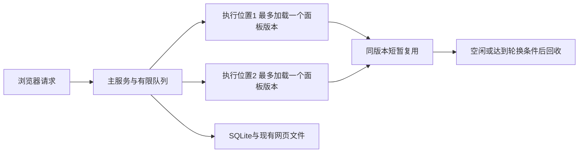

# Panel resource lifecycle

## 需要你处理的事项

### 需用户提供的信息

无。已读取并按原版本核对用户提交的事件38，共10条批注。

### 需用户拍板的决策

- **B14**：推荐用**全局最多2条、按面板版本有限复用的执行线程**，而不是每次serverAction结束就销毁。相同版本优先复用；空闲60秒、完成100次调用或存活5分钟后在任务边界回收。单条线程只加载一个版本，不无限积累面板模块。取舍：短时间多次调用更少重复启动；1–10个活跃面板切换时若未命中保温版本，仍有冷启动。保持全局资源上限优先，不按每面板预留线程。推荐采用，尚未批准。
- **B15**：推荐**不增加30秒HTTP可见报告/90秒续约**。利用显示/隐藏事件和现有WebSocket：隐藏时断开该网页的面板/偏好通知连接，回来再连接、读一次状态；已有15秒协议ping/pong继续检测失联。取舍：没有新增业务层轮询，但仍有现有连接保活网络包，隐藏期间状态通知到回来再补。若要求完全没有任何周期网络包，需要同时改变现有保活；目前没有替用户做这个决定。

### 需用户确认的风险

- **C2**：推荐只回收过期的**生成代码目录**：每个panel保留当前和前一成功版本，以及正被页面、排队/运行任务引用的版本；不删源码、SQLite事件或用户内容。用于防止反复reload积累无限编译版本。代价：被回收的任意旧revision静态URL不能保证重放。是否允许回收须确认；本轮不执行删除。新批注/事件是用户主动新增数据，本方案不靠删它们制造“磁盘恒定”。

### 已确认结论

- **B4**：尚未发布首版，不考虑历史接口兼容。
- **B5**：当前只设计，不开发运行机制。
- **B6**：批注绑定用户当时看到的原文和版本。
- **B7**：页面持有展示数据，组件通过明确props、回调与serverAction组合；批注不依赖后台业务Map。
- **B8**：未提交草稿在浏览器内存，本次不新增草稿持久化。
- **B10**：serverAction及其模块调用process.exit，不得结束Paneon主服务。
- **B13**：面板总数固定、用户同时活跃使用不超过10个时，旧面板无需手动close，Paneon后台资源应有上限并收敛；在此基础上优先提升reload、响应速度和保活体验，不以“每次调用后立即归零”为目标。

旧B1–B3、B9、B11撤回，不是已确认结论。原C1“必须额外把原始文件快照落盘”已撤回。B12按次销毁建议因事件38的目标修正撤回，由B14/B15/C2替代；不是用户已接受的设计，编号不复用。

## 本次目标与边界

用户并不是要求“没有请求时必须立即0线程”，而是：假定只活跃使用少量面板，即便很多旧面板没close，后台资源也不按它们逐个增加；固定总量下，活跃程度变化应在有限资源范围内饱和，而不是每激活一页再开一套常驻后台。在这个前提下减少重复加载、让reload和切回页面好用。

推荐全局最多2条执行线程、32个等待请求、1个编译进程、有限文件清单缓存；源码监听只跟随可见的watch页面。线程短暂保温，空闲后退出。打开1、5、10个活跃页面，不等于常驻1、5、10个执行进程。这里资源上限是明确设计参数，不是尚未测得的绝对RSS承诺。

浏览器内存仍与页面内容有关；同一面板总数下，单纯打开/运行不不断生成新磁盘文件。新建面板、新增批注、修改源码是新增数据，不能承诺任意历史无限保存而磁盘恒定。生成代码版本可按C2有限保留；C2未确认前不执行回收，也不宣称磁盘已受控。

不增加普通/常驻、休眠/唤醒类别，不要求agent填写资源参数。Git/PR交互、UI、布局和组件props不改。

## 推荐架构与线程复用

一个主Node服务处理HTTP、网页、SQLite、队列和现有凭据。serverAction与其模块初始化、完整输入/事件schema在独立Node工作线程执行，不进入主HTTP线程。线程是同一OS进程内的独立JS环境，不是每panel一个子进程，也不是恶意代码OS沙箱。



每条线程只加载一个固定serverEntry真实路径+revision，逐次执行任务，不在一个线程中不断import不同面板。收到队首请求时优先找同版本空闲线程；无匹配且有空位就新建；达到2条但有不匹配的空闲线程，先回收最久未用的空闲线程，等实际exit再加载新版本；2条都忙则等待。队列FIFO，不因追求缓存命中让前面的请求饿死。

相同版本可以有两条线程，因此模块变量本来就不能作为唯一业务状态。线程中的模块可能暂时复用，也可能因空闲、版本切换、错误或轮换被丢弃；功能必须依靠显式输入、浏览器状态或作者明确选择的持久存储。

### 同一个panel同时调用3个serverAction

```text
冷启动：创建线程A、B，各加载该panel同一版本的serverAction模块。
调用1 → A；调用2 → B；调用3先等待。
A完成调用1 → 返回结果、清理本次上下文 → 用A执行调用3。
全部完成 → A、B短暂保温，之后的同版本调用可复用。
连续60秒无任务 → 线程退出。没有新请求时不预热。
```

首次同时3次调用最多创建2条，不是每个调用创建/销毁一轮。Git命令自身仍是3次短时Git进程，这属于真实工作，复用执行线程不会把3条Git命令自动合并成1条。

每条线程完成100次调用或存活5分钟后标为待回收；等当前任务结束再退出，不中途打断正常调用。空闲60秒由一次性定时器回收，不用周期网络轮询。任务结束时abort本次signal、释放job上下文和凭据引用；不声称可以自动识别/清理任意未await的任务或不听signal的定时器。返回后继续后台业务不在支持契约内。线程old-generation建议128MiB上限，不等于完整RSS/Buffer/原生内存限制。

## 按用户操作看全过程

| 操作 | 明确行为 |
| --- | --- |
| run面板 | 编译和校验输入、保存记录与网页；不为每个历史panel预留线程 |
| 打开旧链接 | 读取目标记录和已有网页；页面需要数据时再调用serverAction |
| 同一页连续查询 | 优先复用同版本线程；结果留在浏览器，不放后台业务Map |
| 只看文件、写草稿 | 原文与草稿在浏览器；无需让后台持续工作 |
| 明确提交批注 | 沿用事件接口，已声明schema后写SQLite；不重读最新文件 |
| 标签隐藏 | 保留iframe和草稿，暂停可选的定时业务刷新，关闭该网页的通知连接；已开始业务不取消 |
| 切回页面 | 恢复通知连接并读一次最新状态、偏好；watch页面检查源码变化；可选定时查询最多补一次 |
| 显式reload/源码更新 | 编译并发布新版本；旧版本线程不接新任务，在途任务结束后回收，不额外保留旧执行环境 |
| 服务重启 | 不逐个加载/编译历史panel；在途业务不恢复，已存记录和已提交事件保留 |
| 真正刷新/关闭网页 | 不承诺恢复未提交草稿，已提交事件不丢 |

## 数据到底在哪里


| 位置             | 内容                                               | 生命周期                                           |
| ---------------- | -------------------------------------------------- | -------------------------------------------------- |
| 浏览器内存       | 当前展示原文、视图、批注草稿、页面查询结果         | 当前网页生命周期；不会因一次serverAction结束而清空 |
| SQLite panels    | 面板ID、入口、cwd、创建参数、revision、状态等记录  | 持久化；不新增表/字段                              |
| SQLite events    | 明确提交的事件与批注                               | 持久化；不自动删除                                 |
| SQLite consumers | agent事件投递、确认游标                            | 持久化；读与ack仍独立                              |
| 磁盘编译目录     | 网页JS/CSS、serverAction产物、manifest.json清单    | 持久化；不做自动清理                               |
| 主服务内存       | 有上限的清单缓存、排队请求、当前可见连接、现有凭据 | 缓存/请求有界；不是文件内容与批注的业务存储        |
| 有限复用的执行线程     | 一个固定面板版本的模块及当前调用临时变量                           | 调用临时变量完成即释放；模块在有限保温期内复用，不承诺跨请求状态                   |

**manifest与本方案的关系仅是沿用已有文件清单，给旧链接返回网页时不再依赖常驻执行进程。它不是新设计的存储系统，不是数据库字段，也不是Git文件快照；无需用户单独评审这个术语。**它只是编译器写出的文件清单。当前本机已核实一份真实文件：

```text
/Users/yuguo/.paneon/panels/instance-3a8bf4aa-4dca-4e43-a87b-ab18d2d61f9f/sha256-4a386f9b6cf618e4d37832e13875a9fc7d927ef1122687d154e6f7ea1f5fc558/manifest.json
```

现有目录形态不变：

```text
~/.paneon/panels/<instanceId>/sha256-<revision>/
  manifest.json
  client/frame.html
  client/client.js
  server/server.js
```

清单关键字段摘录（不是整份清单）：

```json
{
  "definitionId": "zero-worker-discussion",
  "clientEntry": "frame.html",
  "serverEntry": "server/server.js",
  "assets": ["client.js", "frame.html"]
}
```

现有SQLite结构继续使用，不升级schema版本：

```sql
CREATE TABLE schema_meta(version INTEGER NOT NULL);
CREATE TABLE panels(
 id TEXT PRIMARY KEY, definition_id TEXT NOT NULL, entry_path TEXT NOT NULL,
 cwd TEXT NOT NULL, params_json TEXT NOT NULL, revision TEXT NOT NULL,
 watch INTEGER NOT NULL, status TEXT NOT NULL, created_at TEXT NOT NULL,
 updated_at TEXT NOT NULL, requires_json TEXT NOT NULL,
 paneon_version TEXT NOT NULL, diagnostic_json TEXT
);
CREATE TABLE events(
 id INTEGER PRIMARY KEY AUTOINCREMENT,
 instance_id TEXT NOT NULL REFERENCES panels(id), revision TEXT NOT NULL,
 type TEXT NOT NULL, payload_json TEXT NOT NULL, created_at TEXT NOT NULL
);
CREATE INDEX events_instance_id_id ON events(instance_id,id);
CREATE TABLE consumers(
 instance_id TEXT NOT NULL REFERENCES panels(id), consumer_id TEXT NOT NULL,
 last_delivered_id INTEGER NOT NULL DEFAULT 0,
 last_ack_id INTEGER NOT NULL DEFAULT 0, updated_at TEXT NOT NULL,
 PRIMARY KEY(instance_id,consumer_id)
);
```

Store.get改为主键SQL，只解析目标params；list也不能用all()解析全部params再裁切，需SQL分页/投影。静态路由由记录revision推导目录，只返回清单允许的文件，不再依赖常驻执行对象。清单缓存最多32份且合计8MiB，超大清单只读取不驻留；淘汰缓存不删文件。主服务不保留全部panel的模块缓存；全局2条执行线程每条最多加载一个版本，换版本先退旧线程。重启不扫描所有源码或重建所有历史；产物缺失时只对访问的实例返回现有不可用诊断，不批量重建。

## 批注提交：checkFeedback究竟做什么

当前Git页面的真实链路是两次请求，不能把它说成神秘的来源真实性验证：

```text
浏览器已有文件原文、选中位置、批注
  ↓ buildGitFeedback：在浏览器组装成一份JSON
请求1：checkFeedback(JSON)
  后台只对这份JSON做格式、引用、片段对应检查
  不执行Git，不读磁盘文件，不查以前线程的Map，不保存批注
  检查通过后把JSON返回浏览器
请求2：agent.emit('git-review-submitted', JSON)
  框架按事件schema接收 → SQLite保存 → 返回事件ID
```

也就是说同一批数据先发送去检查、回来后再发送去保存，多了一次独立往返。它属于我们自己实现的数据一致性检查，不能拿“用户可能漏填”解释，因为这些字段由内置页生成。没有证据证明内置页会生成缺项，也不能把这个检查包装成证明Git原文真实的安全能力。

与资源改造的关系只有：不能要求请求1和请求2落在同一个有业务快照Map的线程。现有Git已满足显式传数据。是否移除独立checkFeedback是未获批准的另一项简化建议；本次不新增、不顺带删除，不把它放进B14的批准包。框架已声明的Zod schema语义、revision/实例状态、大小上限和明确保存保持不变。

浏览器里显示`const n = 4;`时写的批注，提交仍携带这份原文，不能用后来磁盘上的999替换。PR仍有必需session/snapshot Map，实施需像Git一样显式传固定版本与路径、由浏览器持原文，不改变UI。

## 页面刷新、可见变化和连接保活分开说明

### 可选的业务数据定时刷新

只有面板作者明确写了refreshMs才有定时刷新，默认不是每个页面都轮询：

```tsx
useQuery(readStatus, {}, { refreshMs: 5000 });
// 这表示：完成一次查询后，约5秒再读一次业务数据。
// 标签隐藏：不再开始下一次定时读取；已开始的读取可以完成。
// 标签恢复：最多补一次新读取，之后恢复原频率；不重叠执行。
```

当前Git页面没有配置refreshMs，不能把这里说成Git现有卡顿的根因，也不会因此让Git页面突然每5秒请求。显式按钮调用、mutation和提交批注不自动重复。

### 不新增30秒HTTP可见状态报告

此前方案是每30秒发一次“我还可见”，90秒没收到则过期。它确实是新增的周期网络报告，本轮撤回推荐，不把用户的质疑当成认可。

B15新推荐复用现有状态WebSocket：只有宿主document可见且正在显示该panel时连接；隐藏/pagehide时主动关闭，且隐藏期间不重连。回来重新连接，主服务将该连接登记为可见引用；断开就释放。偏好通知连接同样隐藏关闭、回来获取最新偏好，不卸载iframe。多窗口按连接聚合，只要还有一个可见连接就保持源码监听。宿主CSS隐藏iframe也必须触发断开，不能只依赖iframe自己的visibilitychange。

现有代码`src/runtime/server.ts`已经每15秒向通知连接发WebSocket ping，浏览器协议层自动pong；上轮没有响应，下轮终止连接。网络异常时通常在约15–30秒加调度延迟后释放引用，不承诺精准截止。这不是读取Git/业务数据，也不需要浏览器JS定时发HTTP请求，但确实是周期网络保活包。**本轮推荐沿用，不把它说成“完全没有心跳”。**若用户要求连协议保活也取消，需评审失联检测延迟，而不是偷偷留下。

源码监听只有一个框架级Vite watcher，按可见watch连接依赖路径引用计数；最后引用消失则unwatch。回来只检查自己的依赖，变化才编译；no-watch仍只显式reload。可见状态不是人眼检测，不保证识别所有窗口遮挡。连接失效不推断业务回滚、不关闭浏览器内容、不删除批注。

## 延时与实验到底测了什么

### 旧实验：不是测页面打开，也不是测Git

本机Node v24.16.0。此前取了另一份我们写的方案说明页，把它编译后得到的**服务端JavaScript文件**作为加载样本。这个文件是858484字节，里面包含该页声明的函数和数据校验代码；不是网页截图、不是Markdown文本、也不是浏览器渲染产物。

每次计时包含：

```text
主程序开始计时
→ new Worker 创建一条Node线程
→ 线程import这份server/server.js
→ 调用页面input schema检查空参数{}
→ 主程序结束线程，等exit
→ 停止计时
```

以最多2条并发完成30次，中位数39.1ms、95%样本不超过55.5ms。未运行Git、未打开浏览器、不含HTTP，也不代表任意panel或真实点击。它说明“按次销毁会反复付启动/加载成本”，不能证明新复用方案已实现或点击变快。这组数值仍是此前实验，不是本轮重测。

原脚本`/tmp/paneon-request-executor-spike/check.mjs`，结果`result.json`，加载文件：

```text
~/.paneon/panels/instance-dde8bb32-1c24-44b3-897c-064574f84f88/
sha256-82a402999d166ac10e52f5a0f941292f004924466ae1af69fa042a4d157b7034/server/server.js
```

### 本轮原型：3次调用能否少建线程

脚本`/tmp/paneon-reuse-pool-review-20261024/check.mjs`，结果`result.json`。独立原型先加载上述真实JS文件，然后用原型函数执行只读Git的branch、log、status三次并行请求：创建2条线程、完成3次、未逐次销毁；第四次调用仍复用，没有新建。测试用100ms代替建议的60秒空闲回收，最后两条线程退出。

这不是Paneon运行时实现，不是内建Git serverAction端到端验收；未验证多版本替换和长期内存收敛。原型耗时包含真实Git，不能与旧实验无Git的39.1ms直接比较。这里只用它验证“三次调用不必创建销毁三轮”的机制。

## 参数、排队和失败

建议配置`~/.paneon/config.json`，execution为拟新增，保留现有ui字段：

```json
{
  "ui": {"theme": "light", "language": "en"},
  "execution": {
    "maxWorkers": 2,
    "idleTimeoutMs": 60000,
    "maxCallsPerWorker": 100,
    "maxWorkerAgeMs": 300000,
    "maxQueuedTasks": 32,
    "queueTimeoutMs": 10000,
    "defaultTaskTimeoutMs": 30000,
    "maxConcurrentBuilds": 1
  }
}
```

推荐范围：maxWorkers1–8；idleTimeout0–300秒；maxCalls1–1000；maxWorkerAge30–1800秒；queue0–128；等待1–60秒；单次任务1–600秒；编译并发1–2、编译60秒。0空闲期表示任务完成即可回收；这是配置能力，不是默认策略。输入/事件schema默认10秒。参数是推荐初值，尚非测得的最佳容量。

**“等待最多10秒”不是执行最多10秒。**两个线程都忙时，第三个请求先排队；从进入队列开始10秒内若还没开始，就报忙碌并删除等待请求，之后不会偷偷运行。若等了2秒后开始，之后才开始计算该调用默认30秒执行时限；这两个时钟分开。创建/换版本加载在执行时限内。长Git/HTTP调用也占执行位置，FIFO无优先级。

线程状态为starting/busy/idle/retiring，全部计入maxWorkers。任务状态为queued/starting/running/completing/settled，主服务唯一settled标记处理超时与结果竞争；worker同一时刻只处理一项。

| 情况 | 处理 |
| --- | --- |
| 正常返回 | 校验JSON结果、abort本次signal并释放上下文/凭据引用，返回结果；线程进入有时限idle供同版本复用，不固定多等500ms |
| 超时/显式取消 | abort，最多500ms清理，再terminate该线程；真实exit后才腾位置；不带着未知悬空工作继续复用 |
| 模块/handler直接exit或异常 | 本次失败、回收该线程，其他线程/主HTTP继续；mutation已开始时结果可能不确定，不自动重发 |
| 同步JS卡住 | 主HTTP线程按时限终止该线程；整机CPU竞争仍有影响，不承诺绝对响应时间 |
| 显式reload | 发布新revision，新调用只用新版本；旧版本正在执行的任务结束即退线程，不额外保活旧执行环境 |
| close/stop | 去掉对应等待任务，取消正在执行的任务，回收闲置匹配线程；不删已提交事件 |
| 普通断连/隐藏 | 不等于业务回滚，不自动取消已派发业务；任务有独立执行时限 |

普通HTTP与静态资源不占执行位置。编译默认一个短时CompilerProcess，作者元数据也不在HTTP主线程执行。原生import固定serverEntry，不重建Vite执行runner。保留Host/Origin/控制令牌/revision、请求256KiB与事件64Ki UTF-16限制。凭据依然由主服务按job/instance/revision/action授权，当前调用结束即释放引用，不因线程保温跨调用携带凭据。

## serverAction使用约束，用代码说明

### “工作完成再返回”是什么意思

支持：按钮触发一次Git读取，等Git结束，把结果给页面。

```ts
handler: async (ctx) => {
  const result = await execFileAsync('git', ['status', '--short'], {
    cwd: ctx.cwd,
    signal: ctx.signal,
  });
  return { text: result.stdout }; // 这里返回时，Git已经结束
}
```

不支持把serverAction当长期后台服务：

```ts
handler: async () => {
  setInterval(() => scanRepository(), 5000);
  return { started: true }; // 返回了，但还打算每5秒无限扫描
}
```

线程可能空闲、轮换或换版本回收，因此后面的无限扫描不能靠它保活。页面需要重复显示数据可明确用refreshMs；真正持续业务应由外部服务运行。不承诺池化后自动清理任意不听取消信号的定时器。

### ctx.cwd是什么意思

cwd是“这一次调用应在哪个目录执行”，来自agent运行面板时的`paneon panel run ... --cwd /work/repo-a`。

```ts
execFileAsync('git', ['status'], { cwd: ctx.cwd, signal: ctx.signal });
// 相当于：这次Git在/work/repo-a目录执行。
// 另一个面板传/work/repo-b，不需要修改整个Node进程的工作目录。
```

共享进程不能把process.cwd()当每panel独有目录；Node工作线程也不支持process.chdir。传明确cwd是环境调整，不改变Git组件的仓库路径props。普通路径用resolve(ctx.cwd, relativePath)。拟新增serverAction.timeoutMs可为某项操作单独指定1–600秒时限。

### 仍然不提供的能力

模块顶层常量/schema/纯函数可用；不能依赖跨请求模块Map。Git/gh子进程要await并传signal。原生库必须支持worker_threads；不支持就明确报错，不静默回到主HTTP线程或每panel常驻进程。线程隔离只覆盖直接process.exit、普通异常与同步JS任务终止；不声称隔离恶意kill整个PID、原生库进程崩溃或任意脱离管理的外部子进程。

## 磁盘生成版本的有限保留（C2待确认）

每panel保留当前成功版本和前一个成功版本；再保留可见页面、等待/执行任务正在引用的版本。编译失败的临时目录清理；成功发布/引用释放时触发合并后的回收，不为每个panel设轮询。旧版本有空闲保温线程时先退线程，再解除引用，不删正在读取的文件。排队任务最多32、执行线程最多2、可见使用按用户前提不超过10，因此额外被引用版本也由这些有上限对象决定。

回收只针对生成的client/server/manifest目录，不碰panel源码和SQLite事件。引用状态以主服务正在管理的连接/任务为准；恢复页面先取当前revision再发新调用。服务崩溃遗留临时目录需在访问/编译对应panel时清理，不能每次启动重新执行所有历史模块。任意旧revision深链可能不可重放，须C2明确同意后实施。若拒绝C2，则保留所有历史编译版本，并明确磁盘可能随源码更新增长，不冒称已经有界。

## 接口、实施位置与验收

| 接口 | 变更 |
| --- | --- |
| POST /api/panels | 编译、输入schema后保存，不预留panel专属线程 |
| GET /api/panels/:id | 目标主键记录与已有文件清单 |
| GET /panels/:id/:revision/* | 静态文件不依赖live执行对象；C2批准后回收版本可能不可用 |
| POST /api/panels/:id/actions/:actionId | 有限复用线程池与FIFO队列，维持JSON返回 |
| POST /api/panels/:id/events | 已声明schema在线程执行，主服务事务追加；原文不依赖后台Map |
| GET /api/panels/:id/stream | 沿用现有WebSocket；B15下只在可见时连接，连接级引用替代新增presence |
| GET /api/preferences/stream | 隐藏停止通知连接，恢复时获取当前偏好；保留协议保活 |
| POST /api/panels/:id/reload、/close | 显式操作与线程版本回收 |
| GET /api/resources | busyWorkers/idleWorkers/queuedTasks/activeBuilds/visibleWatchInstances |
| paneon config get/set、SDK | execution字段、ctx.cwd/timeoutMs、宿主有效可见桥接消息 |

不新增HTTP presence接口，不改变DB schema或迁移/清空用户数据。框架提示支持en/zh-CN与light/dark，不加资源浮条。计划仓库paneon，分支0.0.x，复核HEAD 5a04d9f0c2a45b2979e1d226387e3e9ef46023b7；工作区另有并行改动，不回退或提交。确认现状：每panel仍fork；Store.get仍全表解析；PR仍有session Map；Git无状态重构已提交282dfda。

实施必须证明：

- 固定100/1000历史记录，分别活跃使用1、5、10个panel：执行线程始终不超过2，单线程只加载一个版本；没有请求先有限保温、超时后0，不再要求调用刚结束就0。
- 同一panel同时3个serverAction最多创建2条，第三次能复用；跨10个版本反复切换不能在两条线程中积累全部模块；记录冷/热耗时与替换次数，不只报线程数量。
- 多轮请求和reload后RSS/FD回到稳定范围而非持续上升；原生Buffer/库内存另测，不把128MiB V8上限冒充全进程上限。
- 显示/隐藏/多窗口/关闭/失联时现有WS引用正确释放，无新增30秒HTTP报告；隐藏不重连、不触发refreshMs查询，回来一次状态同步；iframe与草稿不因线程闲置回收消失。
- 重启不逐panel编译或求值；get/list不用全表params解码；C2批准后生成版本保留/引用释放/在途任务/崩溃临时文件验证，不删用户数据。
- 模块顶层和handler的exit/异常/死循环期间真实HTTP仍响应；超时不复用未知任务线程；副作用不自动重试。
- 全部内建模块、Zod、cwd、凭据跨复用任务隔离、Git/gh取消、PR无后台Map验证。原文批注与Git/PR UI真实浏览器对照；测commit点击各段端到端延时，不用独立原型代替。

## 实施改动文件


下列为同仓库计划源码/文档，不包含测试文件，当前没有实施：

```text
src/runtime/task-executor.ts
src/runtime/task-worker.ts
src/runtime/source-watch.ts
src/runtime/artifact-retention.ts
src/runtime/lifecycle.ts
src/runtime/server.ts
src/runtime/store.ts
src/runtime/preferences.ts
src/runtime/credentials.ts
src/runtime/worker.ts (移除长期IPC实现)
src/compiler/index.ts
src/compiler/process.ts
src/shared/types.ts
src/shared/execution.ts
src/sdk/server.ts
src/sdk/client.ts
src/sdk/protocol.ts
src/web/panel-host.tsx
src/web/api.ts
src/web/preferences.tsx
src/cli/config.ts
src/cli/index.ts
src/ui/locales/en.ts
src/ui/locales/zh-CN.ts
skills/paneon/assets/panels/git-review/actions.ts
skills/paneon/assets/panels/git-review/git.ts
skills/paneon/assets/examples/github-pr/github.ts
skills/paneon/assets/examples/github-pr/schema.ts
skills/paneon/assets/examples/github-pr/panel.tsx
skills/paneon/references/authoring.md
skills/paneon/references/git-review.md
skills/paneon/references/github-pr.md
skills/paneon/references/cli.md
README.md
```

## 本轮评审批注与说明页

事件38对应旧revision sha256:f04c84364c23e6bed37d7b6d0dfcc942a1851d9373df860ca2e9d6f519eb8ad9，10条引用均逐字校对。原批注和原文快照留在/tmp/paneon-zero-worker-discussion-20261024/review-38-original.json，不将新文字套用旧偏移。

同一说明页增加“本轮批注”入口，逐条展示用户意见、处理结果与代码例子；主体同步改为B14有限复用、B15不新增可见HTTP轮询、C2待确认的编译目录保留策略。仍只设计、不开发产品、不自动同意或删除数据。

instance为instance-3a8bf4aa-4dca-4e43-a87b-ab18d2d61f9f，consumer为resource-request-design-review。更新与验收完成后ack事件38；用户后续done再读取更正事件，按完整替换处理。
